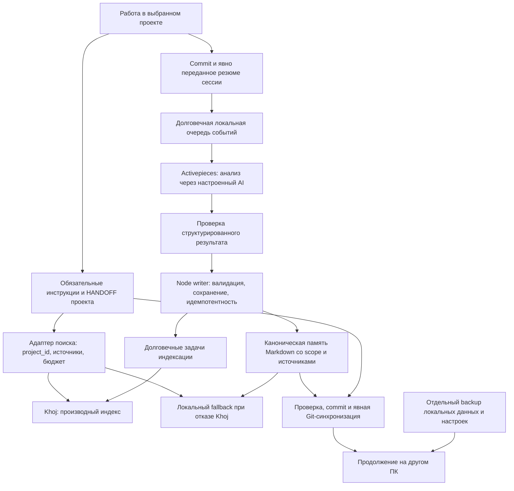

# План доработки System2 для проверки Opus 5

> Историческая версия, отправленная Opus на ревью. Замечания получены и учтены 9 сентября 2026 в [актуальном задании Sonnet](SONNET-PROMPT.md). Пользователь выбрал `D:\SystemTheBest\System`; роли согласованы, внешняя приёмка F01–F04 до настоящей памяти обязательна, добавлено немедленное сохранение без сервисов. Открытые вопросы ниже отражают состояние до этого ревью и не требуют повторного согласования закрытых решений. Для исполнения использовать SONNET-PROMPT.md.

Дата: 9 сентября 2026. Автор: текущий независимый проверяющий.
База аудита: `69a257c5e6b6b97dbca1f0afe1d8ffbf9292919f`, репозиторий https://github.com/gorelovmaxon-cyber/System.

## 1. Что я предлагаю и что прошу проверить

Предлагаю сохранить согласованную архитектуру System2 и довести существующую реализацию. Sonnet 5 самостоятельно составляет тикеты на доработки и выполняет их; независимый проверяющий проверяет результат. Сначала устраняем потерю данных и смешение памяти проектов, затем восстанавливаем надёжность очередей/индекса, после этого принимаем живые интеграции и перенос между ПК.

Opus, у тебя большой контекст исходных обсуждений. Проверь, соответствует ли этот план намерению пользователя, какие прежние договорённости я упустил и где предлагаемые изменения недостаточны или избыточны. Нужен разбор плана и конкретные поправки; этот документ сам по себе не поручает тебе запускать реализацию.

Сравнение ниже выполнено с сохранёнными `.scratch/system-completion/SPEC.md` и `PLAN.md`. Я не видел всей твоей переписки и не могу утверждать, что эти файлы отражают все последние решения. Не называю этот план заменой твоего исходного замысла.

Статус документа: предложение на ревью. Код системы по нему ещё не исправлялся. Уже подготовлен [проект задания Sonnet](SONNET-PROMPT.md); после твоих замечаний его нужно согласовать с итоговым планом.

## 2. Что известно, а что пока не доказано

Публикация с другого ПК состоялась: есть код, переносимая память, планы и SC-01…SC-18. HANDOFF обновлён вечером 8 сентября. Git не переносит локальные секреты, очередь, настройки и данные сервисов; наличие клона не означает работающую систему на новом ПК.

В независимом ограниченном ревью ядра воспроизведены 10 дефектов. Полный [отчёт](evidence/CORE-AUDIT-2026-09-09.md) и [сценарии](evidence/core-audit.cjs) приложены. Самые существенные:

| Область | Наблюдаемая ошибка | Практический результат |
|---|---|---|
| Writer | Второе предложение одной категории из одного события пропускается | Система подтверждает сохранение неполной памяти |
| Восстановление writer | Запись intent считается persisted, даже если файла ещё нет | После сбоя можно получить ложное подтверждение |
| Блокировка writer | Оставшийся после гибели процесса lock не восстанавливается | Последующие записи перестают работать |
| Поиск | В файле смешаны scopes, а поиск учитывает только первый | Проект A получает текст проекта B |
| Очередь | Второй обработчик забирает активное событие, затем результаты перетираются | Успешная доставка может стать failed |
| Журналы | Оборванный JSONL-хвост блокирует чтение всей очереди | Корректные старые события становятся недоступны |
| Индекс | Теряются задачи, зависает in-flight, частичный успех считается полным | Новая память не находится, статусы вводят в заблуждение |

Эти ошибки проверены на синтетической памяти без настоящих сервисов. Они не объясняются отсутствием Docker или ключа AI.

Обычная одиночная запись, точный повтор завершённого события, отклонение неверного scope/категории и базовая HTTP-авторизация bridge прошли проверку. Это не полный аудит безопасности.

Я ещё не провёл независимую приёмку всех SC-01…18. Нельзя из найденных ошибок выводить, что весь код плох или что причина исключительно в модели Luna. Доказан факт недостаточной реализации отдельных контрактов и недостаточной прежней приёмки. Вклад качества тикетов, окружения и исполнения ещё нужно разделить.

## 3. Какая система должна получиться для пользователя

Пользователь открывает выбранный проект на одном из ПК. Помощник читает обязательные инструкции и короткий HANDOFF этого проекта, получает общие предпочтения и выборочно находит релевантную память. Он понимает, что уже сделано, почему принято решение и какой следующий шаг. Пользователю не приходится пересказывать сохранённый контекст.

После работы сохраняются содержательное резюме, решения и результаты проверок. Commit дополняет историю технических изменений; явное резюме сохраняет причины, которые нельзя надёжно восстановить из diff. Событие проходит очередь и анализ; writer проверяет предложения и сохраняет память. Новые сведения становятся доступны поиску после индексации.

На другом ПК помощник получает опубликованные файлы и HANDOFF. Локальные подключения и сервисы восстанавливаются по понятной инструкции; неперенесённые очереди и данные не объявляются восстановленными. Общие предпочтения доступны в проекте B, но состояние и частные записи проекта A в его контекст не попадают.

Система поддерживает разработку, сайты и маркетинг поверх общей инфраструктуры. Различаются маршруты и критерии качества задач. Figma используется для задач с макетом, Gemini остаётся внешним источником исследований. Это не означает автоматический сбор всех чатов или постоянную работу при выключенном компьютере.

## 4. Архитектура: что хранит и делает каждый компонент

Стрелки обозначают логические связи, а не обещание, что каждый шаг уже автоматизирован. Ветка «AI не нашёл нового знания» должна завершаться явным успехом без записи. Подтверждение доставки требует отдельного проверяемого контракта, описанного ниже.

| Компонент | Ответственность | Что он не заменяет |
|---|---|---|
| `.claude/memory/` | Источник сохранённых знаний: содержание, scope, evidence, статус и история изменений | Очередь доставки и резервную копию всей машины |
| HANDOFF проекта | Короткое состояние конкретной работы, причины и следующий шаг | Глобальный профиль и полный архив чата |
| Node-модули | Capture, очередь, проверка и запись, адаптер поиска, локальная диагностика | Большой новый фреймворк |
| Activepieces | Управление анализом события и обработкой результата AI | Право AI произвольно писать файлы или выполнять команды |
| Khoj | Поиск по разрешённой памяти; перестраиваемый индекс | Первичный источник истины о знаниях |
| Git | Перенос проверенных отслеживаемых файлов и история изменений | Сохранность ignored/untracked-данных |
| Backup/restore | Восстановление очередей, настроек, flow/данных сервисов и нужного локального состояния | Автоматическую синхронизацию всех ПК |

Не предлагаю добавлять центральный сервер или заменять Khoj/Activepieces. Конкретный механизм транзакций/журналов нужно выбрать после сравнения вариантов. По умолчанию работаем в существующей структуре; новая БД или новый сервис не являются заранее заданным решением.

## 5. Обязательные свойства, которые нужно уточнить до правок ядра

### Сохранение и повтор

Один event_id может содержать несколько предложений. Успешный ответ означает, что весь обещанный набор доступен в памяти, а повтор не размножает записи. Если процесс прервался, повтор доводит операцию до корректного состояния или сообщает явную восстанавливаемую ошибку.

Rename одного файла не делает атомарной операцию над несколькими файлами и журналом. Sonnet должен описать границы транзакции, состояния intent/commit и восстановление. Не требуется обещать мгновенную атомарную видимость всех файлов, если исходная SPEC этого не требует; требуется исключить тихую потерю и ложный успех. Opus, проверь, достаточно ли этого или была договорённость о более сильной атомарности.

### Граница между проектами

Каждая запись/возвращаемая выдержка должна иметь проверяемый scope. Общий файл с разными scopes допустим лишь при корректном разборе отдельных записей и фильтрации каждого фрагмента. Альтернатива — отдельные записи/файлы с однозначным scope. Выбор должен учитывать старую память, конфликты Git, размер индекса и стоимость миграции.

Я не предписываю сейчас конкретную новую раскладку файлов. Требую тестами доказать отсутствие выдачи B в контексте A и сохранение общих записей независимо от порядка записи. Та же граница действует при формировании данных для внешнего AI: один проект не добавляет туда чужую память автоматически.

### Подтверждение доставки

Нужно различить получение webhook и завершение обработки. HTTP 2xx от триггера может не означать, что AI отработал и writer сохранил результат. Пока этот контракт не проверен на выбранном Activepieces, нельзя считать delivered доказательством persisted.

Sonnet должен установить, где есть долговечное принятие ответственности за событие. Допустимы ожидание результата, коррелированное подтверждение либо проверенная долговечная передача flow с наблюдаемым итоговым статусом. Конкретный вариант выбирается по реальным возможностям версии, без добавления компонентов ради схемы. Не должно быть окна, в котором исходная очередь уже забыла событие, а восстановить обработку больше некому.

Это вопрос для проверки архитектуры и интеграции, а не один из десяти уже воспроизведённых дефектов живого Activepieces: живой стек ещё не проверялся.

### Индекс, синхронизация и качество знаний

`persisted` — память сохранена; `indexed` — выполнена требуемая индексация; `synced` — отслеживаемые изменения опубликованы по согласованному механизму. Один статус не следует автоматически из другого. Ошибки производного индекса не отменяют память, но остаются видимыми и восстанавливаемыми.

Подтверждённое предпочтение требует источника, а не высокой confidence модели. Исправление и supersedes сохраняют происхождение и старую версию согласно договорённости; поиск не выдаёт устаревшее как актуальное. Физическое удаление данных и сохранение исторической версии — разные операции: если исходный контекст различает их, это нужно перенести в контракт, а не смешивать.

## 6. План выполнения с результатом каждого этапа

### Этап A. Сверка и самостоятельная нарезка Sonnet

Проверить текущий HEAD, локальные изменения, среду и исходные SC. Создать матрицу SC-01…18 → R → реализация → evidence → дефект/ограничение → собственный FIX-тикет. Первым делом воспроизвести ошибки ядра. Проверку доступов начать здесь, чтобы поздно не обнаружить отсутствие обязательного сервиса; потенциально разрушающую настройку не выполнять в рамках одной диагностики.

Sonnet сам выбирает число FIX-тикетов и зависимости. Тикет содержит цель, затрагиваемые контракты, алгоритм, отрицательные сценарии и приёмку. Повторная объёмная нарезка всей системы с нуля не нужна. Уже исправные части не переписываются ради нового исполнителя.

Результат: короткий план ремонта, полная матрица покрытия исходного объёма, первая готовая группа FIX-тикетов. Новые находки пополняют этот же пакет, не образуя бесконечный новый архитектурный план.

### Этап B. Целостность памяти и изоляция

Исправить F01–F04: пакетную запись, восстановление intent, блокировки и смешение проектов. Проверить совместимость старой памяти и миграцию на отдельной копии. Затем независимый проверяющий оценивает этот блок до использования с настоящими записями.

Результат: writer сохраняет все предложения, повтор и сбой не теряют данные, поиск соблюдает scopes. Это первый контрольный рубеж, на котором также измеряются время, число переделок и доступные расходы Sonnet.

### Этап C. Очередь и восстановление журналов

Исправить F08–F10, проверить владение задачей, повтор capture, ограниченные повторы, backoff и восстановление повреждённого хвоста. Сценарии должны включать отдельные процессы и принудительную остановку именно тестового процесса.

Результат: не теряются корректные события, живой обработчик не лишается владения от просмотра статуса, устаревший результат не затирает подтверждённый.

### Этап D. Индекс и достоверность состояния

Исправить F05–F07: восстановление недостающей задачи, возврат прерванной работы, итог по всем файлам события. Проверить retry/backoff и семантику изменения/superseded/удаления, включая поиск. До живого Khoj проверяется логика адаптера и журналов; успешная фикстура отдельно обозначается как локальная проверка.

Результат: после восстановления зависимостей все необходимые изменения могут быть проиндексированы; статусы и ошибки соответствуют действительности.

### Этап E. Живые интеграции и остальные исходные SC

Настроить совместимые Khoj и Activepieces по подтверждённым версиям, проверить сеть контейнер → bridge, импортируемый и исполняемый flow, AI-схему, ветку без знания и подтверждение обработки. Запуск с настоящими ключами и платными вызовами — только в рамках имеющейся авторизации.

По матрице завершить исправления hooks, bootstrap, HANDOFF, конфигурации, Figma, маршрутов и evidence. Независимые локальные задачи можно делать раньше, если это не мешает исправлению ядра. Нет необходимости ждать ключ Figma, чтобы исправить очередь.

Результат: работающий и документированный цикл на одном ПК плюс честный список недоступных обязательных проверок, если такие останутся.

### Этап F. Перенос, restore и независимая приёмка

Проверить реальное продолжение на втором ПК, общую память и изоляцию проектов, конфликт Git, неотправленную очередь и восстановление сервисов из backup. Изолированный клон — полезная промежуточная проверка, но не замена второго устройства.

Независимый приёмщик сверяет итог с R01…R13 и исходным намерением пользователя, проверяет критичные сценарии, а не только отчёты Sonnet. До этого результат исполнителя awaiting-review. Недоступная обязательная проверка остаётся awaiting-validation и не превращается в READY.

## 7. Различия с сохранённым исходным планом

| Вопрос | Сохранённый SPEC/PLAN | Предлагаемая доработка | Причина и последствие |
|---|---|---|---|
| Архитектура | Локальные Node + Khoj + Activepieces + Git | Сохраняется | Ошибки не доказывают необходимость замены компонентов |
| Роли | Планировщик → Sonnet пишет тикеты → Luna выполняет → приёмщик | Sonnet сам пишет FIX-тикеты и выполняет; независимая приёмка сохраняется | Прямое пожелание пользователя; меньше передачи контекста, но нужна внешняя проверка |
| Начальная точка | Реализация SC-01…18 из исходного состояния | Ревью текущей реализации и адресные исправления | Код уже существует; повторное выполнение «как с нуля» растратит время и может потерять полезное |
| Очерёдность | Обычный порядок SC-01 → … → SC-18 | Сначала целостность памяти/изоляция, затем очередь/индекс, затем живой цикл | Известные дефекты ядра можно исправить без ожидания внешних сервисов |
| Статусы | Приёмка каждого результата перед дальнейшей работой | Самопроверка каждого FIX; внешние проверки на критичных рубежах и финале | Требует согласования с Opus: уменьшает число ручных передач, не должно ослабить контроль |
| Тесты | Сбои, параллельность и изоляция уже требовались | Добавлены конкретные воспроизводимые сценарии F01…F10 и регрессии | Это исполнение прежних требований, а не новое расширение объёма |
| Старые тикеты | Изначальная нарезка и исторические статусы | Исправление противоречий с датированной историей и связями на FIX | Пользователь попросил перепроверить и исправить сами тикеты; нельзя задним числом заявлять небывшую приёмку |
| Работа при внешнем блокере | Явный blocked/awaiting-validation | То же, плюс продолжение независимых исправлений | Отсутствие ключа не оправдывает незавершённые локальные задачи |
| Экономика | Измерять фактические затраты | Замерить первый блок Sonnet и стоимость принятого результата | Нет доказательства, что новая схема будет дешевле; сокращение переделок — гипотеза |

В исходном плане уже были правильные требования о сохранности, сбоях, изоляции и честной приёмке. Я не предлагаю выдать их за свои новые архитектурные идеи. Главное изменение — исполнитель и способ доведения уже написанного кода.

В моём подготовленном SONNET-PROMPT допускается продолжать следующие доступные FIX после локальных тестов, а независимая приёмка описана главным образом в конце. Для памяти предлагаю усилить это промежуточным внешним ревью этапа B. Это осознанное уточнение к моему собственному заданию, которое нужно внести после согласования с Opus.

## 8. Какие решения я не хочу навязывать без твоей проверки

1. Формат памяти: отдельные записи/файлы против строгого разбора блоков в существующих файлах. Нужна изоляция и сохранность; конкретная раскладка пока не выбрана.
2. Транзакции writer: насколько сильная атомарность требовалась между несколькими файлами и как обеспечить восстановление без лишнего сервиса.
3. Подтверждение webhook/AI-flow: где долговечно хранится ответственность и как виден конечный результат обработки.
4. Работа двух ПК: сохраняется ли локальный writer на каждом устройстве с явным Git merge, или ранее оговаривался иной режим. Центральный writer здесь не вводится.
5. Подтверждение знаний: какие действия допустимы автоматически для observation/confirmed, учитывая исходные договорённости пользователя.
6. Переходы между FIX: достаточно ли внешней проверки после блока writer и финальной приёмки, либо нужно больше промежуточных рубежей.
7. Семантика удаления, superseded и хранения исходного текста: что должно оставаться в рабочей памяти и что только в истории.

Если решение уже есть в большом контексте, укажи его источник и перенеси в явный контракт. Не нужно заново спрашивать пользователя о том, что он уже согласовал.

## 9. Доказательства готовности и ограничения тестов

Новый регрессионный тест должен падать на старой реализации и проходить на исправленной. При проверке старой реализации использовать изолированную копию; не reset текущей работы. Для конкуренции и аварий нужны отдельные процессы, а для интеграций — действительные сервисы. Остановка процесса не равна проверке отключения питания: уровень гарантий нужно сформулировать честно.

Исходный `evidence/core-audit.cjs` намеренно проверяет наличие дефектов. Его успешное выполнение означает, что ошибки воспроизвелись. Его нельзя использовать как зелёный критерий исправленной системы. Исторический JSON сохраняется отдельно; новые результаты — в новых файлах.

Финальная проверка: задача A → явное резюме/событие → анализ → все предложения сохранены → индекс обновлён → поиск с источниками → синхронизация → продолжение на другом ПК. В проекте B доступен общий профиль без частного контекста A. Повторить с отказом сервиса, перезапуском процесса и конфликтом синхронизации. Проверить restore, Figma и маршруты в пределах исходной SPEC, сохраняя явные статусы недоступных проверок.

Готовность означает достигнутое наблюдаемое поведение. Количество коммитов, отсутствие синтаксических ошибок и отчёт модели сами по себе этого не доказывают.

## 10. Какой ответ нужен от Opus

Прошу дать:

1. Вердикт: план годится / годится после конкретных правок / нарушает исходный замысел.
2. Отличия от твоего фактического плана, включая договорённости, отсутствующие в сохранённых SPEC/PLAN.
3. Обязательные поправки к архитектурным контрактам и порядку работ с кратким объяснением последствий.
4. Пропущенные критерии приёмки и требования, которые здесь ошибочно добавлены или ослаблены.
5. Итоговые корректировки к SONNET-PROMPT, после которых Sonnet сможет сам нарезать FIX-тикеты и выполнить доработку.

Не требуется заново написать все FIX-тикеты за Sonnet: это его задача по поручению пользователя. Проверяем направление и границы, чтобы он не реализовал аккуратно неверную систему.
